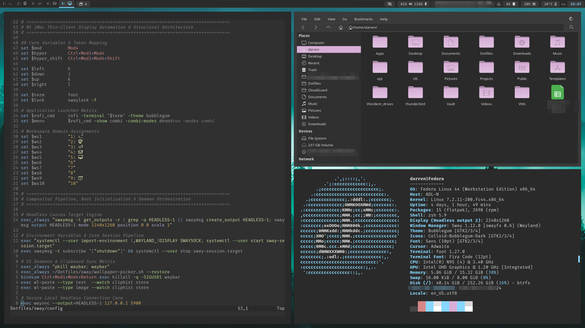
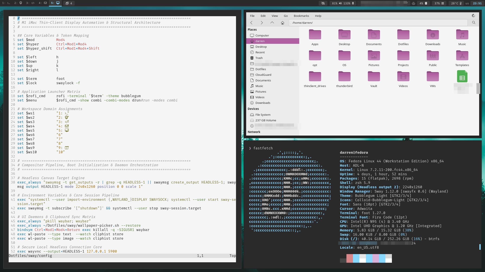
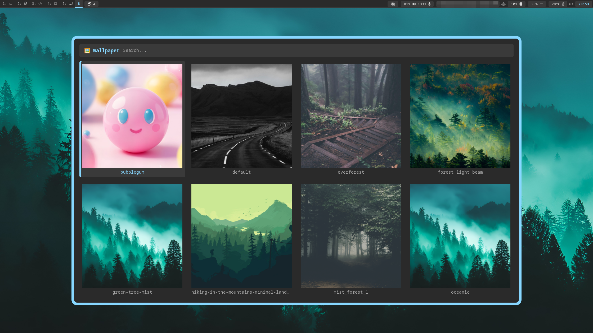
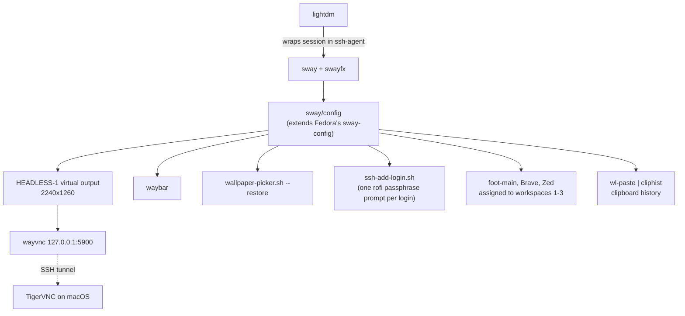
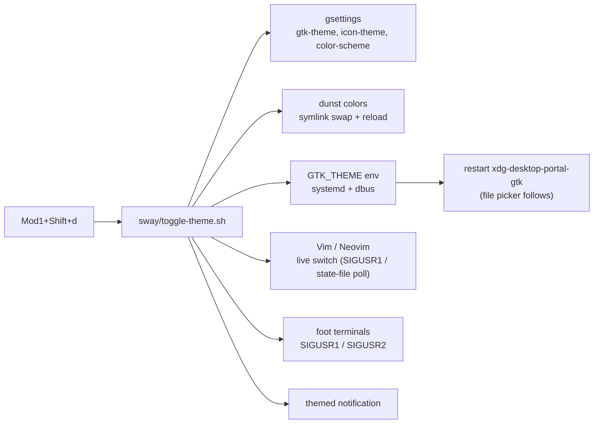

# Dotfiles

A Wayland-only **Fedora Sway** workstation, described entirely in files: compositor, bar, launcher, terminal, editors, prompts, notifications, GTK/icon themes, and a keyboard layout, all wearing one custom palette called **Bubblegum**. One idempotent script rebuilds it on a fresh machine.

The machine is used mostly as a **headless thin-client desktop**. Sway renders to a virtual output that `wayvnc` streams to a TigerVNC client on a Mac, so the setup is designed to feel right over a remote link: no Xwayland, keyboard-first window management, and a handful of small scripts that make tiling workflows one keypress.

| Dark | Light |
|---|---|
|  |  |

Both screenshots are the same workspace (Neovim, Thunar and a terminal) before and after pressing `Mod1+Shift+d`. Below is the rofi wallpaper picker:



---

## Highlights

- **One palette, everywhere.** Bubblegum (dark and light) is implemented for GTK 3/4, the XDG file-chooser portal, Colloid-derived icon folders, dunst, rofi, waybar, foot, btop, Zed, SpeedCrunch, Brave, Vim and Neovim.
- **One keypress flips the whole desktop** between dark and light, including icons, notifications, the file picker, and running Vim/Neovim sessions.
- **Remote-friendly and locked down.** `wayvnc` binds to `127.0.0.1` only and is reached through an SSH tunnel, and the SSH key is unlocked once per login session.
- **Wayland-only by design.** The install script avoids X11 packages and tools (`xsel`, `xclip`, X11 screenshot tools). `Xwayland` is present only because Fedora's sway config package hard-requires it.
- **Extends Fedora's sway config** instead of replacing it, so the stock bar and defaults keep working.
- **Safe, repeatable bootstrap.** `install.sh` supports `--dry-run`, never deletes (existing files are moved aside as `*.bak.<timestamp>`), and can be re-run at any time.
- **Public-repo hygiene.** No keys, tokens or personal identifiers. Private material lives in a separate repo that the installer clones only if you opt in.

---

## Architecture Overview

How a login becomes a working desktop:



How the theme toggle (`Mod1+Shift+d`) propagates:



### Window workflow

`foot-main` is a named terminal (`app-id=foot-main`) that several scripts rely on as the "home" terminal on workspace 1. The scripts keep it alive and put it where it belongs:

| Script | Behaviour |
|---|---|
| `open-terminal.sh` (`Mod+Return`) | On workspace 1: pull an existing `foot-main` home, or create it. Elsewhere: a normal terminal. |
| `ensure-foot-main.sh` | Creates `foot-main` if it is missing; used by the split scripts. |
| `foot-zed-split.sh`, `foot-brave-split.sh`, `zed-brave-split.sh` | Toggle a two-app side-by-side "focus" workspace (9) and send the apps home on the second press. |
| `sway-dynamic-pair.sh` | Rofi menu that pairs any two open apps into the split workspace. |
| `toggle-titlebars.sh` | Show or hide tab titlebars while staying in a tabbed layout. |
| `wallpaper-picker.sh` | Rofi thumbnail grid (ImageMagick thumbnails, cached) that applies and persists a wallpaper. |
| `screen-recorder-toggle.sh` | Start/stop `wf-recorder`. |

---

## Key Technical Decisions

| Decision | Why |
|---|---|
| **swayfx** (sway fork) | Same config and IPC as sway, plus blur, rounded corners and shadows. Installed with `--allowerasing` because it replaces stock sway. |
| **Extend, don't replace, Fedora's sway config** | The spin's stock bar, session units and defaults stay intact; local config layers on top. |
| **Headless output + wayvnc** | A fixed, known-size virtual display means a consistent layout no matter which client connects. |
| **VNC on loopback, reached over SSH** | The remote display is never exposed on the network; authentication and encryption are left to SSH. |
| **Plain files, no framework** | Symlinks and shell scripts only. Easy to audit, nothing to update, and trivial to reason about. |
| **foot over heavier terminals** | Fast, Wayland-native, small config; named windows via `--app-id` make it scriptable from sway. |
| **Pure prompt, no oh-my-zsh** | Fast startup. The zsh config is a handful of sourced files. |
| **GNOME `color-scheme` as the source of truth** | GTK apps, portals, Vim and Neovim all already understand it, so the toggle needs no custom IPC. |
| **Colloid icons recoloured by script** | `make-bubblegum-icons.sh` rebuilds Bubblegum folder colours from the upstream theme, so there is no forked icon theme to maintain. |
| **Seed, don't symlink, SpeedCrunch's ini** | The app rewrites its settings constantly; a tracked copy seeds fresh installs without dirtying the repo. |
| **Dependency-free Vim/Neovim colourschemes** | Plain `highlight` definitions with dark and light palettes; no plugin manager needed. |

---

## Project Structure

```text
Dotfiles/
├── install.sh              # idempotent Fedora 44 Sway bootstrap (--dry-run, --links-only)
├── sway/                   # sway(fx) config and helper scripts (see table above)
├── waybar/                 # bar config and stylesheet
├── foot/                   # terminal config (Bubblegum colours)
├── rofi/                   # launcher theme (bubblegum.rasi)
├── dunst/                  # notification daemon: layout + dark/light colour files
├── themes/                 # GTK 3/4 themes: "Bubblegum" and "Bubblegum Light"
├── icons/                  # icons used by notifications and launchers
├── wallpapers/             # bundled wallpaper(s), copied to ~/Pictures/Wallpaper
├── docs/screenshots/       # README images
├── nvim/                   # Neovim: init.lua + neovim-bubblegum colourscheme
├── vim/                    # Vim: vimrc + Bubblegum colourscheme
├── zsh/                    # zshrc and shell functions (vault helpers, ssh agent)
├── aliases                 # shell aliases
├── bash-scripts/           # utilities linked into ~/.local/bin (clip, bw-get, icon builder, ...)
├── btop/  yazi/  zellij/   # TUI tool configs (btop has a Bubblegum theme)
├── zed/                    # Zed settings, keymap and Bubblegum theme
├── brave/                  # Brave browser theme (load unpacked)
├── swappy/                 # screenshot annotation config
├── SpeedCrunch/            # calculator colour schemes and seed settings
├── ipython/                # IPython profile
├── glove80/                # Glove80 (ZMK) keyboard layout, keymap and firmware
└── gnome/ linux/ wezterm/ spaceship/
                            # legacy material from earlier setups, kept for reference
```

### Notable scripts in `bash-scripts/`

| Script | Purpose |
|---|---|
| `clip` | Copy stdin to the clipboard with `wl-copy` on Wayland or `xsel`/`xclip` on X11. The `copy` alias and Bitwarden helpers use it. |
| `make-bubblegum-icons.sh` | Builds Bubblegum-coloured copies of the Colloid icon themes. |
| `make-bubblegum-accents.sh` | Generates the blue and green accent variants of the GTK and icon themes (`bubblegum-accents.sh` holds the palette). |
| `bw-get`, `cb-clear` | Bitwarden CLI helper and clipboard clearing. |
| `toggle_gaps_sway.sh` | Toggle inner/outer gaps. |

### Key bindings (excerpt)

`Mod` is Super. The "hyper" chord is `Ctrl+Alt+Super`.

| Keys | Action |
|---|---|
| `Mod+Return` / `Mod+d` | Terminal (smart `foot-main`) / launcher |
| `Mod+h/j/k/l` | Focus left/down/up/right |
| `Mod+b`, `Mod+v`, `Mod+w`, `Mod+s`, `Mod+e` | Split horizontal, split vertical, tabbed, stacking, toggle split |
| `Mod+Shift+Return`, `Mod+f`, `Mod+t` | Fullscreen scratchpads: btop, yazi, terminal |
| `Hyper+t`, `Hyper+a`, `Hyper+z`, `Mod+Shift+z` | Foot+Zed, Foot+Brave and Zed+Brave splits, dynamic pair menu |
| `Mod1+Shift+d` | Toggle dark / light Bubblegum |
| `Mod1+Shift+a` | Pick the accent colour (pink / blue / green / mono) from a rofi menu |
| `Mod+Shift+w` | Wallpaper picker |
| `Mod+c` | Clipboard history (cliphist + rofi) |
| `Mod+Shift+o` | OCR a screen region to the clipboard |
| `Ctrl+Mod+a/s/w` | Screenshots via grimshot (area, output, window); add `Shift` to annotate in swappy |
| `Mod+Shift+r` | Toggle screen recording |

See `sway/config` for the complete list.

---

## Quality Highlights

- **Idempotent installer.** Re-running reports `ok` for links already in place and changes nothing. Every step is skipped when its result already exists.
- **Dry run.** `./install.sh --dry-run` prints every action without touching the system.
- **Non-destructive.** Anything that would be overwritten is renamed to `<name>.bak.<timestamp>`.
- **Verified in isolation.** The link phase was exercised against a throwaway `$HOME`: all links created correctly, a second run made zero changes, backups worked, and the zsh prompt and aliases loaded. A full run on a fresh VM is the next planned test; the package list was checked against the Fedora 44 repositories.
- **Behaviour tested, not assumed.** Helper scripts (terminal handling, vault locking, theme toggle, the foot+Zed split) were exercised against a live sway session, including failure paths such as a missing `foot-main`, a busy vault and stale aliases.
- **Secrets stay out.** The installer has no credentials. Git identity, SSH keys and private aliases are handled outside the repo; the SSH key is loaded once per login through a rofi passphrase prompt, never stored.
- **Shell syntax checked.** `bash -n` on the installer and scripts; the zsh config is sourced in a clean interactive shell as a smoke test.

---

## Getting Started

> Target: a fresh **Fedora 44 Sway spin**, run as a normal user. The repo must live at `~/Dotfiles`.

```bash
git clone https://github.com/Darren-Haynes/dotfiles.git ~/Dotfiles
cd ~/Dotfiles

./install.sh --dry-run      # review what will happen
./install.sh                # install packages, apps, and create symlinks
./install.sh --links-only   # only (re)create symlinks/config, no installs
```

What it does, in order:

1. Enables repositories (RPM Fusion, selected COPRs, Brave) and installs `swayfx`, the CLI/TUI tools, the Sway session pieces (waybar, foot, rofi, dunst, grim/slurp/swappy, wf-recorder, wayvnc, ...), Neovim, fonts, and Brave.
2. Adds Flathub, the Zed editor, the Pure prompt, and the Colloid icon theme (then recolours it to Bubblegum).
3. Symlinks configs into `~/.config`, `~/.themes`, `~/.vimrc`, `~/.zshrc` and helper scripts into `~/.local/bin`.
4. Sets zsh as the login shell, Brave as the default browser, and the Bubblegum GTK/icon defaults.

After it finishes, log out and back in. The script prints the remaining manual steps:

- **Git identity and SSH key** (keep these private; generate with `ssh-keygen -t ed25519` and add the public key to GitHub).
- **Optional private dotfiles:** set `PRIVATE_DOTFILES_REPO=<ssh url>` and re-run with `--links-only` to clone a separate private repo (private aliases, etc.).
- **Brave theme:** load `~/.local/share/bubblegum/brave-theme` via `brave://extensions` (Developer mode, Load unpacked). The directory is generated from `brave/brave-theme-bubblegum` (dark and light manifests) and follows the theme toggle; a running Brave picks up the change on its next start, or when you press Reload on its card in `brave://extensions`.
- **Remote desktop:** `wayvnc` listens on `127.0.0.1:5900`; enable `sshd` yourself if you want to reach it through an SSH tunnel.

### Using the pieces on their own

Everything is plain files, so you can take just what you want:

- **Neovim:** `ln -s ~/Dotfiles/nvim ~/.config/nvim`
- **Vim:** `ln -s ~/Dotfiles/vim/vimrc ~/.vimrc && ln -s ~/Dotfiles/vim/colors ~/.vim/colors`
- **GTK theme:** `ln -s ~/Dotfiles/themes ~/.themes`, then `gsettings set org.gnome.desktop.interface gtk-theme 'Bubblegum'`

---

## Branches

`master` tracks the current Fedora Sway setup. The earlier GNOME-based setup lives on the `gnome` branch.

---

## License

Personal configuration, shared for reference and inspiration. Third-party themes and icons (for example Colloid) remain under their own licences.
